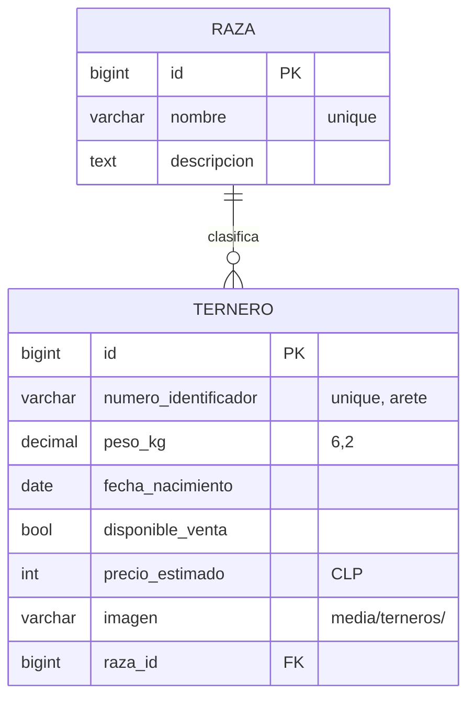

# AgroGanadera — Sistema de Gestión de Ganado


Aplicación web desarrollada en **Django 5** para administrar un campo ganadero dedicado a la crianza y
venta de terneros. Permite clasificar el ganado por raza (modelo padre, administrado desde el Django
Admin) y gestionar la ficha completa de cada animal (modelo hijo) —incluida su fotografía, su
disponibilidad para la venta y su precio en pesos chilenos— mediante un CRUD web completo construido
con Vistas Basadas en Clases sobre **MySQL 8**.

Proyecto de la **Evaluación Sumativa 3 (Hito 3)** de la asignatura **Programación Back End (TI3041)**,
Instituto Profesional INACAP, sede Osorno.

---

## Índice

1. [Contexto académico](#contexto-académico)
2. [Funcionalidades](#funcionalidades)
3. [Tecnologías](#tecnologías)
4. [Arquitectura y modelo de datos](#arquitectura-y-modelo-de-datos)
5. [Rutas y permisos](#rutas-y-permisos)
6. [Decisiones técnicas](#decisiones-técnicas)
7. [Puesta en marcha](#puesta-en-marcha)
8. [Datos de prueba y auditoría](#datos-de-prueba-y-auditoría)
9. [Estructura del proyecto](#estructura-del-proyecto)
10. [Historial de desarrollo](#historial-de-desarrollo)
11. [Limitaciones conocidas](#limitaciones-conocidas)
12. [Autor](#autor)

---

## Contexto académico

| | |
|---|---|
| **Asignatura** | Programación Back End (TI3041) |
| **Unidad** | Unidad 2: Framework Back End |
| **Evaluación** | Sumativa 3 (Hito 3) — 30 % de la nota final |
| **Modalidad** | Individual · Taller continuo en laboratorio (3 bloques de 2 h) |
| **Requisito de entrega** | Repositorio GitHub con commits en sala + verificación en MySQL Workbench |
| **Tema** | Libre elección: sistema de gestión de un campo ganadero |

## Funcionalidades

- **Catálogo público** de terneros con fotografía, raza, peso, precio y estado de venta.
- **Ficha de detalle** de cada animal, con la imagen ampliable y todos sus datos.
- **CRUD completo** del modelo hijo: crear, editar y eliminar con confirmación.
- **Precios en formato CLP** (`$450.000`) mediante filtro de plantilla propio `|clp`.
- **Formulario tolerante**: acepta `450000` o `450.000` para el precio, y `120,50` o `120.5` para el peso.
- **Carga de fotografías** por archivo, con vista previa en catálogo y detalle.
- **Autenticación nativa** de Django con protección de las vistas de mutación.
- **Panel de administración** con razas y terneros, filtros, buscador y columnas editables.
- **Mensajes de éxito** descartables (Bootstrap 5) tras cada operación.
- **Diseño propio** con paleta verde/tierra, logotipo institucional y header animado.

## Tecnologías

| Componente | Tecnología |
|---|---|
| Lenguaje | Python 3.11 |
| Framework | Django 5.2 |
| Base de datos | MySQL 8.0 Server (utf8mb4) |
| Conector | PyMySQL 1.2 (registrado como `MySQLdb`) |
| Imágenes | Pillow 13 |
| Frontend | HTML5, Bootstrap 5, Django Template Language |
| Control de versiones | Git + GitHub |

## Arquitectura y modelo de datos

El proyecto respeta el patrón **MVT** y la regla de **exactamente dos modelos con una única relación
1:N**: un modelo padre clasificador gestionado solo desde el Admin y un modelo hijo operativo sobre el
que se construye el CRUD público.



| Modelo | Rol | Campos | Administración |
|---|---|---|---|
| `Raza` | Padre clasificador | `nombre`, `descripcion` | Solo Django Admin |
| `Ternero` | Hijo operativo | `numero_identificador`, `peso_kg`, `fecha_nacimiento`, `disponible_venta`, `precio_estimado`, `imagen`, `raza` (FK) | CRUD web con CBVs |

La ForeignKey usa `on_delete=models.CASCADE` y `related_name='terneros'`, por lo que al eliminar una
raza se eliminan también sus terneros.

## Rutas y permisos

| Ruta | Vista | Acceso |
|---|---|---|
| `/` | `TerneroListView` (catálogo, con `select_related`) | Público |
| `/ternero/<pk>/` | `TerneroDetailView` | Público |
| `/ternero/nuevo/` | `TerneroCreateView` | Requiere sesión |
| `/ternero/<pk>/editar/` | `TerneroUpdateView` | Requiere sesión |
| `/ternero/<pk>/eliminar/` | `TerneroDeleteView` (con confirmación) | Requiere sesión |
| `/login/` y `/logout/` | `LoginView` / `LogoutView` | Público |
| `/admin/` | Django Admin (Razas y Terneros) | Superusuario |
| `/media/...` | Archivos subidos (servidos por Django en desarrollo) | Público |

## Decisiones técnicas

- **Dos modelos, una FK.** La pauta exige exactamente dos entidades relacionadas; `Raza` clasifica y
  `Ternero` opera. El padre no tiene vistas públicas: se gestiona en el Admin para no duplicar el CRUD.
- **`select_related('raza')` en el ListView.** Sin él, la tabla haría una consulta extra por cada fila
  (problema N+1). Con él, Django resuelve la relación en un único `JOIN`.
- **Vistas Basadas en Clases.** `ListView`, `DetailView`, `CreateView`, `UpdateView` y `DeleteView`
  reutilizan lógica por herencia y dejan poco código repetido.
- **`LoginRequiredMixin` a la izquierda.** El orden en la herencia importa: el MRO ejecuta el mixin
  antes que la vista, de modo que la protección ocurre en el servidor aunque el botón no se muestre.
- **PyMySQL en vez de `mysqlclient`.** Es un conector puro en Python: se instala sin compiladores en
  Windows y expone la misma API, registrándose como `MySQLdb` en `agroganadera_project/__init__.py`.
- **`SuccessMessageMixin` + alertas Bootstrap.** El usuario recibe confirmación explícita de cada
  operación, y el mensaje puede cerrarse.

## Puesta en marcha

**Requisitos:** Python 3.11+, MySQL 8.0 en ejecución y Git.

1. **Clonar el repositorio**

   ```bash
   git clone https://github.com/otrolemao/AGROGANADERA.git
   cd AGROGANADERA
   ```

2. **Crear y activar el entorno virtual**

   ```bash
   python -m venv .venv
   .venv\Scripts\activate
   ```

3. **Instalar dependencias**

   ```bash
   pip install -r requirements.txt
   ```

4. **Crear la base de datos en MySQL Workbench**

   ```sql
   CREATE DATABASE agroganadera CHARACTER SET utf8mb4 COLLATE utf8mb4_unicode_ci;
   ```

5. **Configurar la conexión** en `agroganadera_project/settings.py`
   (`DATABASES`: `ENGINE=django.db.backends.mysql`, `NAME=agroganadera`, `USER`, `PASSWORD`,
   `HOST=127.0.0.1`, `PORT=3306`).

6. **Aplicar migraciones**

   ```bash
   python manage.py makemigrations
   python manage.py migrate
   ```

7. **Crear el superusuario**

   ```bash
   python manage.py createsuperuser
   ```

8. **Cargar las fotografías y los datos de prueba**

   Copia las imágenes como `ternero1.jpg` … `ternero10.jpg` (o `.jpeg`, `.png`, `.webp`) dentro de
   `media/terneros/` y ejecuta:

   ```bash
   python manage.py seed_terneros
   ```

   El comando reinicia los terneros, mantiene las razas y asigna cada foto por número de archivo.

9. **Levantar el servidor**

   ```bash
   python manage.py runserver
   ```

   Catálogo: <http://127.0.0.1:8000/> · Admin: <http://127.0.0.1:8000/admin/>

## Datos de prueba y auditoría

La base contiene **4 razas** (Angus, Hereford, Holando, Normando) y **10 terneros** distribuidos entre
ellas, lo que cumple el mínimo exigido (≥ 4 padres y ≥ 10 hijos).

Consultas de verificación para MySQL Workbench:

```sql
-- 1. Conteo de entidades padre (mínimo 4)
SELECT COUNT(*) AS total_razas FROM ganado_raza;

-- 2. Conteo de entidades hijas (mínimo 10)
SELECT COUNT(*) AS total_terneros FROM ganado_ternero;

-- 3. Integridad de la relación con INNER JOIN
SELECT t.numero_identificador, t.peso_kg, t.precio_estimado, r.nombre AS raza
FROM ganado_ternero t
INNER JOIN ganado_raza r ON t.raza_id = r.id;
```

## Estructura del proyecto

```
AGROGANADERA/
├── agroganadera_project/
│   ├── __init__.py                    # PyMySQL registrado como MySQLdb
│   ├── settings.py                    # MySQL, estáticos, media, autenticación
│   ├── urls.py                        # admin, ganado, login/logout, media
│   ├── asgi.py
│   └── wsgi.py
├── ganado/
│   ├── models.py                      # Raza y Ternero
│   ├── admin.py                       # ModelAdmin con list_display, list_filter, search_fields
│   ├── forms.py                       # ModelForm + PrecioCLPField
│   ├── views.py                       # 5 CBVs
│   ├── urls.py                        # rutas con nombre
│   ├── formatos.py                    # formatear_clp()
│   ├── templatetags/
│   │   └── agro_formatos.py           # filtro |clp
│   ├── management/
│   │   └── commands/seed_terneros.py  # datos de prueba + fotos
│   ├── migrations/                    # 0001_initial, 0002_ternero_imagen
│   └── templates/ganado/              # base, catalogo, detalle, formulario,
│                                      # confirmar_eliminar, login
├── media/
│   └── terneros/                      # fotografías subidas (no versionadas)
├── static/
│   ├── css/custom.css                 # diseño propio
│   └── img/logo.svg                   # logotipo institucional
├── prompts_ia.md                      # bitácora de IA en formato RTCF
├── requirements.txt
├── .gitignore
└── manage.py
```

## Historial de desarrollo

El trabajo se organizó en los tres bloques del taller, con commits descriptivos por fase:

| Bloque | Contenido | Commits |
|---|---|---|
| **1** | Fundaciones, MySQL y modelado relacional | `7d723e2`, `96547fa` |
| **2** | CRUD con CBVs y optimización ORM | `ac94e2b` |
| **3** | Seguridad, feedback, estáticos y bitácora | `3cb9e72`, `e08252b` |
| **Mejoras** | Imágenes, formato CLP, validaciones y header | `52c37dc` … `b0a0a76` |

El detalle de los prompts usados con asistencia de IA está en [`prompts_ia.md`](prompts_ia.md).

## Limitaciones conocidas

- **Bootstrap por CDN:** sin conexión a internet se pierden los estilos de Bootstrap (el `custom.css`
  propio se sirve igual).
- **Fotografías no versionadas:** `media/` está en `.gitignore`; hay que copiar las imágenes y ejecutar
  `seed_terneros` después de clonar.
- **Credenciales en `settings.py`:** son de desarrollo local; en producción irían en variables de
  entorno.
- **Sin tests automatizados:** `ganado/tests.py` está vacío; la verificación fue manual y por HTTP.
- **Sin paginación:** el catálogo muestra todos los registros; con volumen alto habría que paginar.
- **`db.sqlite3`:** queda en disco como residuo de la primera versión, fuera del repositorio.

## Autor

**Jorge Martínez** — [@otrolemao](https://github.com/otrolemao)

Proyecto académico desarrollado para INACAP sede Osorno, 2026.
